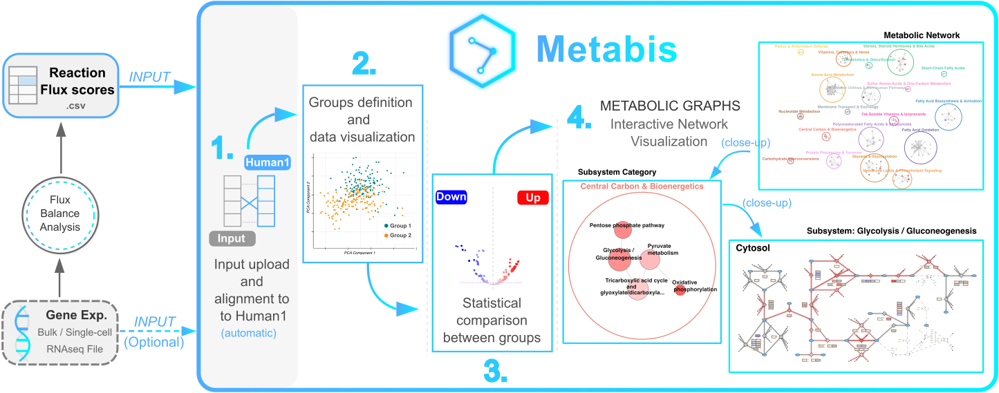

# Metabis



Metabis is an open-source Python library for metabolic data analysis, differential comparison, and metabolic graph visualization. It can be used as a standalone library in notebooks or Python scripts, and it is the analytical backbone behind the public Metabis platform at https://metabis.unav.edu/.

## Installation

Metabis requires Python 3.12. We recommend using conda and creating a dedicated Python 3.12 environment before installing Graphviz and the library.

### 1. Create and activate a conda environment

```bash
conda create -n metabis python=3.12
conda activate metabis
```

### 2. Install Graphviz

`pygraphviz` requires Graphviz to be available before the Python package install. Install it into the same environment with:

```bash
conda install -c conda-forge graphviz
```

### 3. Clone and install Metabis

```bash
git clone https://github.com/GuilleDufortFing/metabis.git
cd metabis
pip install --upgrade pip
pip install -e ".[dev]"
```

If you only need the library without notebook tooling, install from the cloned repository with:

```bash
pip install .
```

## Get Started

The demo notebooks under `demo/` follow the three tutorials of the Metabis server, one each, with the library calls the server makes, so the numbers they print are the app's:

- `demo/01_compass_th17.ipynb`: Compass scores of pathogenic and non-pathogenic Th17 cells (Wagner et al., Cell 2021). It introduces the library as it goes: loading and aligning the data, groups and reductions, a Target/Baseline comparison, the Delta score, over-representation analysis, pathway graphs, Metabolic Atlas maps, element details and adjustment for depth.
- `demo/02_smillie_pseudobulk.ipynb`: Compass scores of seven colon cell types in healthy, non-inflamed and inflamed tissue (Smillie et al., Cell 2019): groups from two metadata columns, comparison sides joined from several groups, each group against the rest, and the analysis overview.
- `demo/03_metaflux_tcga_lung.ipynb`: METAFlux fluxes of 1,017 TCGA lung tumours (Huang et al., Nat Commun 2023): a signed flux matrix, values at a solver's tolerance read as zero, expression already on a log2 scale, log2 fold change, and a reaction map prepared as the paper prepared its own.

Read `01` first; `02` and `03` use what it introduces without introducing it again. When the notebooks are opened from this repository, they automatically add the local `src/` directory before importing `metabis`, so they can run directly from the checkout as long as the Python dependencies are installed.

The example files the notebooks load are installed rather than tracked: they are large, and `data/*.csv`, `data/*.tsv`, and `data/*.h5ad` are gitignored. Install the complete set with:

```bash
python data/download_datasets.py
```

That downloads the author-maintained archive the Metabis server deploys, verifies its recorded SHA-256 digest, and writes each example's reaction, expression and sample-sheet files into `data/`: `Th17_Compass_*.tsv` (notebook `01`), `smillie_pseudobulk_*.tsv` (notebook `02`) and `metaflux_tcga_lung_*.tsv` (notebook `03`). All are tab-delimited, as their `.tsv` suffix says.

The archive is the single source for the example data, so the notebooks and the deployed Metabis server read byte-identical inputs.

## Public interface and versioning

Metabis follows [semantic versioning](https://semver.org/), from the first
stable public-interface release, `1.0.0`. Its current
stable public-interface release is `1.1.0`. Stability is promised for the
supported namespaces only; everything else is implementation that may change
without notice.

[CONTRIBUTING.md](CONTRIBUTING.md) lists those namespaces and states the
compatibility policy, and [CHANGELOG.md](CHANGELOG.md) carries the
release-level summary.

## Included Resources

Metabis ships with the packaged reference-model and graph resources needed for normal library use, so no separate resource checkout is required.
Third-party attribution and upstream license notices for bundled public resources and example data are collected in [THIRD_PARTY_NOTICES.md](THIRD_PARTY_NOTICES.md).

## License

Metabis is released under the [MIT License](LICENSE).

## Contact

For support or questions, please contact [gdufort@fing.edu.uy](mailto:gdufort@fing.edu.uy).

## Acknowledgements

- The Human1 reference model used by Metabis, Human-GEM 2.1.1, was obtained from [Human-GEM](https://github.com/SysBioChalmers/Human-GEM) and is distributed there under the [CC BY 4.0 license](https://github.com/SysBioChalmers/Human-GEM?tab=CC-BY-4.0-1-ov-file#readme).
- The Human1 maps used by Metabis, with Metabolic Atlas's link paths and subsystem bands, were obtained from [Human-maps](https://github.com/SysBioChalmers/Human-maps), whose map files declare the [CC BY-SA 4.0 license](https://creativecommons.org/licenses/by-sa/4.0/); the map files Metabis packages from them are shared under the same license.
- The Compass reaction-flux example data and study context are based on [Compass](https://github.com/wagnerlab-berkeley/Compass), which is distributed under the [BSD-3-Clause license](https://github.com/wagnerlab-berkeley/Compass?tab=BSD-3-Clause-1-ov-file#readme). The associated publication is [Wagner et al., Cell 2021](https://doi.org/10.1016/j.cell.2021.05.045).
- The Smillie example expression subset and sample metadata are derived from the processed data deposited as the public Single Cell Portal study [SCP259](https://singlecell.broadinstitute.org/single_cell/study/SCP259/intra-and-inter-cellular-rewiring-); its reaction matrix is Compass output computed from that subset. The [Single Cell Portal terms](https://singlecell.zendesk.com/hc/en-us/articles/360060798672-Terms-of-service) permit public-study data to be redistributed and reused, and limit it to research use rather than medical, clinical, or diagnostic decisions. The associated publication is [Smillie et al., Cell 2019](https://doi.org/10.1016/j.cell.2019.06.029).
- See [THIRD_PARTY_NOTICES.md](THIRD_PARTY_NOTICES.md) for the bundled notice text carried with the public package.
