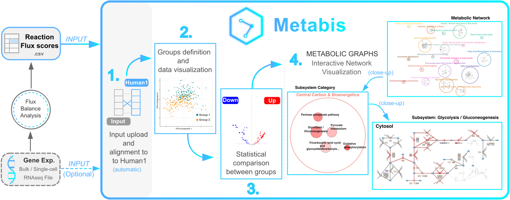

# Metabis



Metabis is an open-source Python library for metabolic data analysis, differential comparison, and metabolic graph visualization. It can be used as a standalone library in notebooks or Python scripts, and it is the analytical backbone behind the public Metabis platform at https://metabis.unav.edu/.

## Installation

Metabis requires Python 3.12. We recommend using conda and creating a dedicated Python 3.12 environment before installing Graphviz and the library.

### 1. Create and activate a conda environment

```bash
conda create -n metabis python=3.12
conda activate metabis
```

### 2. Install Graphviz

`pygraphviz` requires Graphviz to be available before the Python package install. Install it into the same environment with:

```bash
conda install -c conda-forge graphviz
```

### 3. Clone and install Metabis

```bash
git clone https://github.com/GuilleDufortFing/metabis.git
cd metabis
pip install --upgrade pip
pip install -e ".[dev]"
```

If you only need the library without notebook tooling, install from the cloned repository with:

```bash
pip install .
```

## Get Started

The recommended starting point is the staged demo notebook series under `demo/`:

- `demo/01_metabolic_model_and_data_loading.ipynb`
- `demo/02_groups_and_dimensionality_reduction.ipynb`
- `demo/03_group_statistical_comparison.ipynb`
- `demo/04_metabolic_graphs_and_subsystems.ipynb`

Each notebook is self-contained, but the series is ordered from basic object loading to pathway-level interpretation. Together, notebooks `01` to `04` guide you through the main Metabis workflow step by step.

When the notebooks are opened from this repository, they automatically add the local `src/` directory before importing `metabis`, so they can run directly from the checkout as long as the Python dependencies are installed.

If you prefer a single end-to-end case study, use [demo/case_study.ipynb](demo/case_study.ipynb). It applies the same ordered workflow directly to the Th17 example used in the publication and in the Metabis server tutorial that reproduces the Compass paper result.

This repository already includes the Th17 example files used in the demo notebooks and case study under `data/`. To regenerate them from the public Compass dataset, run:

```bash
python data/download_and_process_compass.py
```

The generated files are `data/Th17_Compass_reactions.csv` and `data/Th17_Compass_expression.csv`. They are tab-delimited even though they use the `.csv` suffix.

## Included Resources

Metabis ships with the packaged reference-model and graph resources needed for normal library use, so no separate resource checkout is required.

## License

Metabis is released under the [MIT License](LICENSE).

## Contact

For support or questions, please contact [gdufort@fing.edu.uy](mailto:gdufort@fing.edu.uy).

## Acknowledgements

- The Human1 reference model used by Metabis was obtained from [Human-GEM](https://github.com/SysBioChalmers/Human-GEM) and is distributed there under the [CC BY 4.0 license](https://github.com/SysBioChalmers/Human-GEM?tab=CC-BY-4.0-1-ov-file#readme).
- The Human1 maps used by Metabis were obtained from [Human-maps](https://github.com/SysBioChalmers/Human-maps) and are distributed there under the [CC BY 4.0 license](https://github.com/SysBioChalmers/Human-maps?tab=CC-BY-4.0-1-ov-file#readme).
- The Compass reaction-flux example data and study context are based on [Compass](https://github.com/wagnerlab-berkeley/Compass), which is distributed under the [BSD-3-Clause license](https://github.com/wagnerlab-berkeley/Compass?tab=BSD-3-Clause-1-ov-file#readme). The associated publication is [Wagner et al., Cell 2021](https://doi.org/10.1016/j.cell.2021.05.045).
